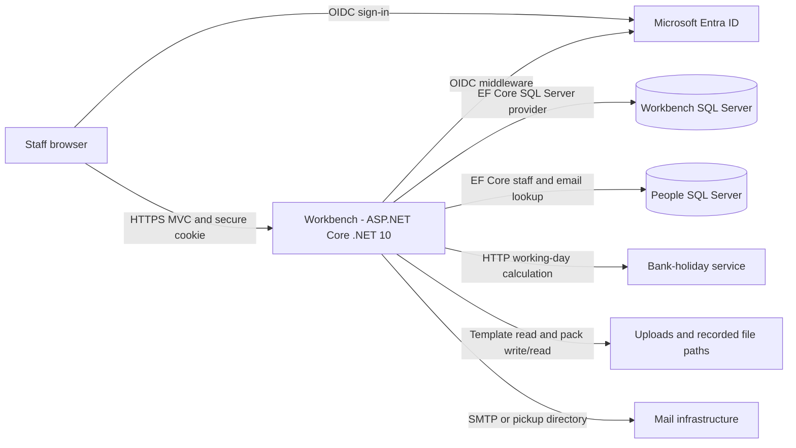

# Assessment - RPA.Inspections.Workbench

> **Superseded data-access assessment (2026-11-09):** Workbench now uses
> `EntityFramework` **6.4.4**, not EF Core 10.0.14. Both contexts use scoped EF6
> SQL Server connections with database initializers disabled. The former EF Core
> baseline artifacts/tooling were removed; do not execute the historical EF Core
> rollout commands or treat the old verification results below as current.
> Entra authentication and Key Vault integration remain in place. Generated packs
> and recorded BCMS report downloads now use private Blob Storage; imports use memory,
> and only the active read-only Excel template is packaged. Existing files/database
> references and the external BCMS producer still require a coordinated rollout. See the
> [current README](..\README.md) for runtime configuration, tests and rollout.
> The remainder of this report preserves the previous assessment as historical evidence.

## Identification

**Repository Name**: rpa-inspections-workbench (solution: `RPA.Inspections.Workbench`)
**Type**: Web Application (ASP.NET Core MVC, server-rendered Razor views)
**Language**: C#
**Frameworks**: .NET 10 (`net10.0`), Entity Framework Core 10.0.14 (SQL Server and lazy-loading proxies), Microsoft.Identity.Web 4.16.1, EPPlus 4.5.3.3, X.PagedList.Mvc.Core 10.6.0
**Repository URL**: Local workspace — `rpa-inspections-workbench`; remote URL not verified
**Assessment Date**: 2026-11-03
**Scope**: Current application/test source, configuration, deployment-artifact inventory and EF6-to-EF-Core implementation/verification. Build, offline tests and EF model/script tooling were executed as recorded below. No fresh AppCAT/security scan, live schema acceptance, deployment or cloud resource changes were performed.

Evidence: [application project](..\RPA.Inspections.Workbench\RPA.Inspections.Workbench.csproj), [startup](..\RPA.Inspections.Workbench\Program.cs), [README](..\README.md).

## Summary

RPA.Inspections.Workbench supports cattle inspection administration: holdings and breeds, inspector assignment, scheme years, archived holdings, inspection-pack requests/downloads and BCMS report requests. It imports spreadsheets and contains Excel inspection-pack generation services. These responsibilities are evidenced by the [Admin](..\RPA.Inspections.Workbench\Controllers\AdminController.cs), [Holding](..\RPA.Inspections.Workbench\Controllers\HoldingController.cs), [BCMS](..\RPA.Inspections.Workbench\Controllers\BcmsAdminController.cs) controllers and [FileService](..\RPA.Inspections.Workbench\Services\FileService.cs).

The web/authentication modernization is already present: .NET 10 hosting, centralized registration through `Program.cs` → `AddWorkbenchApplication`, single-tenant Entra authorization-code OIDC, secure cookie sessions and explicit role policies. Current runtime does **not** load IDT SQL roles, use ASP.NET Membership, or register Windows/Negotiate authentication. There is **no automatic IDT role migration**: identity owners must approve and assign four distinct Entra app-role values and issue the required staff-number claim. The audit claim continues to drive People lookups and pack ownership. See [ApplicationServices, including GetAuditName](..\RPA.Inspections.Workbench\Services\ApplicationServices.cs) and [deployment prerequisites](..\README.md).

This is not yet demonstrated as deployment-ready. EF Core SQL access is implemented and offline-verified, but live schema/write acceptance is outstanding. Windows Integrated Security connection settings, local pack/template storage, a bank-holiday HTTP service and SMTP/pickup delivery remain. Live tenant permission/audit acceptance, infrastructure provisioning and operational validation are outstanding evidence gaps. Historical framework/IDT/EDMX conclusions must not be substituted for the current source.

## Service Dependencies

### Cloud Services (GCP/AWS/Azure)
- **Microsoft Entra ID**: Required external identity provider through Microsoft.Identity.Web. Configuration validates a single tenant and application ID, HTTPS authority, client secret, role mappings and audit claim configuration. Missing required settings prevent startup. [Evidence](..\RPA.Inspections.Workbench\Services\ApplicationServices.cs).
- No AWS/GCP service SDK, Azure storage integration or explicit Application Insights registration was found in the application project/startup. Standard ASP.NET Core logging is configured; deployed telemetry wiring was not inspected.

### Databases
- **Workbench SQL Server**: `WorkbenchContext` now uses EF Core 10.0.14 with typed options, scoped SQL Server registration and lazy-loading proxies. Nine `IW` tables preserve the last archived EF6 storage model's column types/nullability, keys, identity generation and relationships. Normal change detection is deliberately enabled; detached `SetModified` edits and DataAnnotations save validation are retained. EF6 source/resources are archived and excluded from build, never replayed. The new empty existing-schema baseline and full snapshot are deployment-managed. [Context](..\RPA.Inspections.Workbench\DAL\WorkbenchContext.cs), [registration](..\RPA.Inspections.Workbench\Services\ApplicationServices.cs), [baseline](..\RPA.Inspections.Workbench\CoreMigrations\20261103135804_ExistingSchemaBaseline.cs), [rollout](..\README.md).
- **People SQL Server**: Direct EF Core access to `OLA.People`, `OLA.Locations` and `OLA.Managers` remains. Explicit schema/column/length and composite-key mappings preserve source-derived behavior; all tables are excluded from migrations because People is externally owned. Staff numbers still resolve names, emails and assignments; no replacement People HTTP client was added. People mapping has not been compared to a live schema. [PeopleContext](..\RPA.Inspections.Workbench\DAL\PeopleContext.cs), [UserHelper](..\RPA.Inspections.Workbench\Helpers\UserHelper.cs), [HoldingService](..\RPA.Inspections.Workbench\Services\HoldingService.cs).
- Base configuration uses Integrated Security for both SQL connections; environment files override the Workbench connection. Entra browser sign-in does not supply the database process identity or migrate these connections. Current registration requires only Workbench and People connections, not an IDT Security connection. [Configuration](..\RPA.Inspections.Workbench\appsettings.json), [registration](..\RPA.Inspections.Workbench\Services\ApplicationServices.cs).

### Messaging
- No broker, queue or service-bus integration was found in the inspected runtime source.
- Email delivery is implemented separately through SMTP or a pickup directory; database request flags are not evidence of a message broker.

### Storage
- **Application-base `Uploads` directory**: Holds published Excel templates, temporary bulk-import files and generated inspection packs. `PathBuilder` resolves it from the application base directory; imports write/delete files and pack generation saves Excel files there. The project copies templates to build/publish output. This requires writable storage, collision/concurrency consideration and persistence across deployments/replicas. [FileService](..\RPA.Inspections.Workbench\Services\FileService.cs), [project](..\RPA.Inspections.Workbench\RPA.Inspections.Workbench.csproj).
- **Database-recorded file paths**: Pack downloads/deletions and BCMS report retrieval use paths recorded in request entities. Storage changes must preserve or migrate those references, not just copy templates. [HoldingController](..\RPA.Inspections.Workbench\Controllers\HoldingController.cs), [BcmsAdminController](..\RPA.Inspections.Workbench\Controllers\BcmsAdminController.cs), [PackRequestedService](..\RPA.Inspections.Workbench\Services\PackRequestedService.cs).
- **Static images/scripts/styles**: Served from `wwwroot` by `UseStaticFiles`; images are not evidence of a separate mutable upload store. No Blob Storage SDK or abstraction is currently registered.
- **Mail pickup share**: The default mail configuration points to a Windows UNC pickup directory. Accessibility and supported delivery behavior must be validated for the chosen host. [SendService](..\RPA.Inspections.Workbench\Services\SendService.cs).

### APIs and External Integrations
- **Bank-holiday working-days service**: Typed `HttpClient` calls the configured working-days endpoint using `start`/`end` query parameters and parses an integer response. Base configuration selects an internal HTTP endpoint. The handler supplies default credentials to the proxy; this is not evidence that Entra tokens authenticate the downstream service. [HolidayService](..\RPA.Inspections.Workbench\Services\HolidayService.cs), [client registration](..\RPA.Inspections.Workbench\Services\ApplicationServices.cs).
- **Email delivery**: `SendService` selects SMTP network delivery when `Mail:Host` is populated, otherwise specified-pickup-directory delivery. Notification construction and spreadsheet workflow remain in source; pack-request creation has its old email-send call commented out, so email must not be assumed to run for every request. [SendService](..\RPA.Inspections.Workbench\Services\SendService.cs), [MailService](..\RPA.Inspections.Workbench\Services\MailService.cs), [PackRequestedService](..\RPA.Inspections.Workbench\Services\PackRequestedService.cs).
- **Browser links**: Notification bodies contain a fixed internal Workbench HTTP link; the layout also links to internal guidance. These are navigation dependencies, not discovered backend API integrations. [MailService](..\RPA.Inspections.Workbench\Services\MailService.cs), [layout](..\RPA.Inspections.Workbench\Views\Shared\_Layout.cshtml).

### Other Dependencies
- EF Core uses the SQL Server `Microsoft.Data.SqlClient` provider. Its encrypted-connection/certificate defaults require deployment validation; no insecure connection fallback was added.
- EPPlus handles workbook imports and macro-enabled Excel pack templates. Template fidelity must be retained when moving storage or updating the library.
- Locally served jQuery, jQuery UI, Bootstrap and compatibility scripts remain in the Razor layout. Their presence/version strings are static evidence, not a vulnerability scan.
- `AddMemoryCache` is process-local; ASP.NET Core authentication also requires a deliberate data-protection key persistence/sharing strategy. No explicit production key-store registration is present in `ApplicationServices`.

## Communication

### Exposed Endpoints

The conventional route is `{controller=Home}/{action=Index}/{id?}`. Parameters such as holding IDs and file paths are action parameters, commonly supplied through query strings or forms. The table lists current action routes, not speculative REST APIs. **GET*** means a browser GET is supported but the action has no HTTP-method constraint; it is not restricted to GET by an attribute.

| Method | Path | Description | Authentication |
|--------|------|-------------|----------------|
| GET* | `/`, `/Home/Index` | Landing page and policy-controlled navigation | Entra session + Basic Access policy |
| GET* | `/Admin`, `/Admin/Index` | Bulk-upload administration screen | Admin policy |
| POST | `/Admin`, `/Admin/Index` | Import inspection spreadsheet; optional data clearing | Admin **and** Super User policies; antiforgery validation |
| GET* | `/Admin/BreedList`, `/Admin/HoldingList`, `/Admin/ArchiveAdmin`, `/Admin/ArchivedList`, `/Admin/ViewArchivedHolding` | List/search current or archived reference/holding data | Admin policy |
| GET* / POST | `/Admin/AddBreed`, `/Admin/ViewBreed`, `/Admin/AddHolding`, `/Admin/ViewHolding` | Display/create/edit breed or holding records | Admin policy; antiforgery validation on POST |
| GET* | `/Admin/InspectorList`, `/Admin/AddInspector`, `/Admin/RemoveInspector` | Inspector listing/form/removal; removal changes data | Admin policy |
| POST | `/Admin/AddInspector` | Add inspector | Admin policy; antiforgery validation |
| GET* / POST | `/Admin/SchemeYearAdmin` | Display/update scheme controls | Admin policy; antiforgery validation on POST |
| GET* | `/Admin/AddSchemeYear`, `/Admin/PeopleSearch` | Create next scheme year; return People search JSON | Admin policy |
| GET* | `/Holding`, `/Holding/Index`, `/Holding/ViewHolding`, `/Holding/PacksRequested` | Holding search/details and outstanding pack requests | Authenticated session via fallback policy |
| POST | `/Holding/PackRequest`, `/Holding/PeopleUpdate` | Record pack request; attempt current-user email update | Authenticated session via fallback policy |
| GET* | `/Holding/GetPack`, `/Holding/DeletePack` | Download recorded pack or delete/hide it; deletion changes data | Authenticated session via fallback policy |
| GET* | `/BcmsAdmin`, `/BcmsAdmin/Index`, `/BcmsAdmin/open_report` | Recent BCMS requests and recorded HTML report retrieval | BCMS policy |
| POST | `/BcmsAdmin/BulkRequest`, `/BcmsAdmin/SpecificRequest` | Persist bulk/date-range or holding-specific BCMS request | BCMS policy |
| GET | `/Account/AccessDenied`, `/Account/AuthenticationFailed` | Safe 403 and 401 responses | Explicitly anonymous |
| OIDC callback | `/signin-oidc` | Configured identity-provider callback, handled by middleware | OIDC protocol validation; not an MVC business action |
| Unconstrained | `/Error` | Production exception-handler route | No anonymous override; fallback authentication policy applies |

Evidence: [routing](..\RPA.Inspections.Workbench\Program.cs), [Admin](..\RPA.Inspections.Workbench\Controllers\AdminController.cs), [Holding](..\RPA.Inspections.Workbench\Controllers\HoldingController.cs), [BCMS](..\RPA.Inspections.Workbench\Controllers\BcmsAdminController.cs), [Home](..\RPA.Inspections.Workbench\Controllers\HomeController.cs), [Account](..\RPA.Inspections.Workbench\Controllers\AccountController.cs), [Error](..\RPA.Inspections.Workbench\Controllers\ErrorController.cs), [policies](..\RPA.Inspections.Workbench\Services\ApplicationServices.cs).

### Consumed Endpoints
- **GET configured bank-holiday URL** ending in `/api/Values/workingdays`, with `?start=...&end=...`: working-day calculation. The environment-specific hostname is intentionally omitted. Calls synchronously wait on `GetStringAsync`; errors are wrapped as holiday-service unavailability. [Implementation](..\RPA.Inspections.Workbench\Services\HolidayService.cs).
- **Entra OIDC endpoints**: Authorization-code flow through configured authority/tenant and Microsoft.Identity.Web. Endpoint discovery/token handling is middleware-managed, not a bespoke business HTTP client. [Registration](..\RPA.Inspections.Workbench\Services\ApplicationServices.cs).
- SQL and SMTP/pickup-directory access are non-HTTP integrations. No consumed People API route was found.

### Asynchronous Communication
- Pack requests persist `activeRequest`, requester information and timestamps; BCMS requests persist `ActiveRequest`, date ranges or holding/scheme identifiers. UI retrieval reads status and recorded file paths. [Pack request service](..\RPA.Inspections.Workbench\Services\PackRequestedService.cs), [BCMS controller](..\RPA.Inspections.Workbench\Controllers\BcmsAdminController.cs).
- No hosted background worker, scheduler or broker consumer was found in startup/registration. Database flags suggest a deferred-processing hand-off, but the responsible external processor and deployment contract are **not established by this source**.
- SMTP sending and the holiday HTTP wait are synchronous. OIDC event callbacks being asynchronous do not constitute a business messaging integration.

### Communication Diagram



The diagram shows source-evidenced dependencies, not a verified deployed topology; no unlocated request processor is depicted as an implemented service.

## Configuration

### Environment Variables
- ASP.NET Core's default builder loads configuration; environment variables can override nested keys using `__`. These are supported configuration inputs, not evidence that they have been supplied in a deployment. [Program](..\RPA.Inspections.Workbench\Program.cs), [README](..\README.md).
- Required identity inputs include `AzureAd__TenantId`, `AzureAd__ClientId`, `AzureAd__ClientSecret`, `Identity__AuditNameClaimType` and `Authorization__BasicAccessRole`, `Authorization__AdminRole`, `Authorization__SuperUserRole`, `Authorization__BcmsRole`. Authority/callback settings are under `AzureAd`.
- SQL settings are `ConnectionStrings__WorkbenchContext` and `ConnectionStrings__PeopleContext`; mail uses `Mail__Host`, `Mail__Port`, `Mail__PickupDirectory`; holiday access uses `HolidayService__WorkingDaysUrl`.
- `ApplyMigrationsOnStartup` must remain false; true now fails closed before database access. `ASPNETCORE_ENVIRONMENT` selects normal environment-specific settings; no deployed value was verified.

### Configuration Files
- [appsettings.json](..\RPA.Inspections.Workbench\appsettings.json): Logging, allowed hosts, startup migration switch, identity placeholders, SQL connections, mail and holiday-service settings.
- [appsettings.SIT.json](..\RPA.Inspections.Workbench\appsettings.SIT.json), [appsettings.UAT.json](..\RPA.Inspections.Workbench\appsettings.UAT.json), [appsettings.Production.json](..\RPA.Inspections.Workbench\appsettings.Production.json): Workbench connection overrides. They do not independently supply the required identity settings.
- [ApplicationServices.cs](..\RPA.Inspections.Workbench\Services\ApplicationServices.cs): Central configuration validation, identity/cookie/policy setup and dependency registration.
- [project file](..\RPA.Inspections.Workbench\RPA.Inspections.Workbench.csproj): SDK-style package references and template publishing. No current `packages.config`, `Web.config` transforms or EDMX files were found in the inspected project tree.

### Secrets and Sensitive Parameters
- `AzureAd:ClientSecret` is required externally and is not supplied in base settings. Tenant/application identifiers and role values also require environment-specific approval; none are reproduced here.
- Committed SQL settings use Integrated Security rather than embedded SQL passwords. That still requires process-account permissions, network access and a supported hosting identity model; it does not mean database access is secret-free or portable.
- Internal SQL/service addresses, the mail pickup location, sender configuration, file paths and People/requester data require controlled deployment configuration and appropriate access controls. Values are intentionally omitted from this report.
- `AuditNameClaimType` must identify the real People staff number or compatible domain-qualified account claim. Validation rejects missing/duplicate/empty or non-alphanumeric normalized values, but cannot prove a claim represents the correct business identity; live issuance/mapping acceptance is required. [ApplicationServices.GetAuditName](..\RPA.Inspections.Workbench\Services\ApplicationServices.cs), [UserHelper](..\RPA.Inspections.Workbench\Helpers\UserHelper.cs).

## Infrastructure

### Containerization
- **Dockerfile/base image/declared container ports**: None found in the project inventory.
- .NET 10 does not by itself establish Linux/container readiness: Integrated Security, UNC pickup delivery, writable application-base storage and external file producers remain to be addressed.

### Kubernetes/Helm
- **Manifests/Helm charts**: None found in this application's inspected tree. No replica, persistent-volume, ingress or secret-store deployment contract was found.

### Infrastructure as Code
- **Terraform/Bicep/ARM/CloudFormation**: No provisioning templates found in the inspected application tree.
- Azure hosting, networking, SQL placement, storage and secret/key management are recommendations to design, not resources proven to exist.

### CI/CD
- No application-specific pipeline YAML or deployment scripts were found in the inspected tree. Existing `bin`/`obj` outputs do not establish a reproducible delivery pipeline or validation result for this assessment.
- The old `DbMigrator` startup path was removed. A pinned local EF tool, design-time factory, empty existing-schema migration/full snapshot and generated review-only idempotent history SQL provide the deployment mechanism. No pipeline execution or database update was performed. Schema acceptance is mandatory before recording the baseline; no application DDL or People migrations run at startup. [Startup](..\RPA.Inspections.Workbench\Program.cs), [factory](..\RPA.Inspections.Workbench\DAL\WorkbenchContextFactory.cs), [SQL](..\RPA.Inspections.Workbench\CoreMigrations\ExistingSchemaBaseline.sql), [rollout](..\README.md).

### Legacy Deployment Artifacts
- The project retains `AspNetCoreHostingModel=InProcess`, an IIS hosting setting for ASP.NET Core, **not** evidence that the current application still uses MVC 5/.NET Framework.
- README documents IIS/reverse-proxy prerequisites: anonymous host access, Windows authentication disabled for browser sign-in, HTTPS/callback registration, trusted forwarding configuration at the hosting layer and persisted/shared data-protection keys. No production fulfillment was verified.
- The [October assessment export](..\docs\Report_20261006101749_20261006105014.md) is a historical artifact. Its AppCAT results and legacy deployment descriptions are not a fresh assessment of this source.

## Testing

### Coverage
- **Percentage**: Not measured in this assessment; no coverage percentage is asserted.
- **Tooling**: Current `net10.0` test project references NUnit 3.14.0, NUnit3TestAdapter 6.3.1, Moq 4.20.72, Microsoft.NET.Test.Sdk 18.11.0 and Microsoft.AspNetCore.Mvc.Testing 10.0.13. No coverage collector is explicitly referenced in the test project. [Project](..\RPA.Inspections.Workbench.Tests\RPA.Inspections.Workbench.Tests.csproj).

### Test Types
- **Unit**: Attribute validation, cattle calculations, breed/holding/linked-holding services, pack requests, spreadsheet models, file and mail services; EF contexts and external services are mocked in representative tests. [File-service example](..\RPA.Inspections.Workbench.Tests\Services\FileServiceTests.cs).
- **Authentication/policy tests**: Explicit role separation, configuration rejection, audit normalization, People lookup/ownership and helper fallback behavior. [AuthenticationTests](..\RPA.Inspections.Workbench.Tests\Authentication\AuthenticationTests.cs).
- **Offline host integration tests**: `WebApplicationFactory<Program>` exercises OIDC challenges, cookies, safe failure endpoints, policy-controlled MVC/navigation and combined Admin/Super User enforcement. Test-only session endpoints belong to the test assembly, not production routes. [AuthenticationHostTests](..\RPA.Inspections.Workbench.Tests\Authentication\AuthenticationHostTests.cs).
- **Signed-token validation tests**: Local keys/static identity configuration cover valid and invalid tenant/audience/signature/expiry/audit cases through Microsoft.Identity.Web validation. [SignedTokenAuthenticationTests](..\RPA.Inspections.Workbench.Tests\Authentication\SignedTokenAuthenticationTests.cs).
- **EF mapping/relational tests**: Automated parity against the archived February 2024 Workbench EF6 storage model, SQL Server query generation, provider/scoping checks, baseline/snapshot safety and startup rejection; isolated SQLite tests cover tracked/detached edits, validation, cascades, lazy/eager navigation loading, pack/BCMS operations and People staff/email lookup. SQLite does not prove SQL Server execution, collation, datetime rounding or non-key identity generation. [Persistence tests](..\RPA.Inspections.Workbench.Tests\Persistence).
- **Opt-in live SQL acceptance**: Two read-only tests require `WORKBENCH_SQL_TEST_CONNECTION` and `PEOPLE_SQL_TEST_CONNECTION`. They check mapped columns/types/nullability/identity, primary keys, foreign keys/delete actions and navigation reads without creating/updating databases. They were skipped because no explicit test connections were supplied. No real-tenant, SMTP, holiday-service or deployed-browser acceptance was performed.

### Observations
- Fresh 2026-11-03 verification: EF6 baseline **192 passed / 1 skipped / 0 failed**; migrated full suite in both Debug and Release **207 passed / 3 skipped / 0 failed** each (210 total, exit 0). The existing redacted-recipient mail skip remains; the two new skips are live SQL acceptance. App Release and test-project Debug/Release builds succeeded, zero errors. EF tooling restored at 10.0.14, found no pending model changes and generated the baseline script offline. Exact commands/results and acceptance procedure are in the [README](..\README.md).
- Restore/build report pre-existing EPPlus → `System.Drawing.Common 4.7.0` critical advisory **NU1904 / GHSA-rxg9-xrhp-64gj**. It remains an explicit separate dependency/security follow-up, not a clean vulnerability certification.
- Live parity is **unverified**: the supplied local Workbench SQL connection was inaccessible; LocalDB was stopped and Docker's daemon unavailable. Neither was started. No database or Azure resource changes were made. Source-derived mapping tests are not evidence of live schema/data equality.
- Include deployment acceptance for database identity/schema access, template publishing and generated-file retention, mail delivery, holiday service connectivity, reverse-proxy callback behavior and multi-replica/restart cookie continuity.

## Points of Attention for Multi-Cloud/Azure Migration

### Cloud-Specific Dependencies
- Entra is now an intentional identity dependency. A different hosting cloud would still need connectivity and the approved Entra application/claim contracts unless identity is separately redesigned.
- SQL Server/EF Core are not Azure-only, but Windows Integrated Security and the UNC mail pickup setting couple the supplied configuration to the existing Windows/network environment.
- No Azure-native persistence, messaging or secret-store integration is currently evidenced. Adding Azure hosting does not automatically replace disk storage, SQL identities or email infrastructure.

### Hardcoded Configurations
- Base/environment settings retain internal SQL/service addressing, an HTTP holiday endpoint and a UNC pickup path. Externalize and validate these per deployment without exposing sensitive endpoint values.
- Notification HTML embeds an internal Workbench HTTP URL and fixed sender addresses; move deployment-dependent URL/sender choices into configuration. [MailService](..\RPA.Inspections.Workbench\Services\MailService.cs).
- Template/output paths are tied to the application-base `Uploads` directory, while database records retain generated-file paths. Introduce a storage contract before relocating outputs; static `wwwroot` images need not be treated as mutable business storage.

### Legacy Code or Old Patterns
- **Already modernized**: Do not plan another MVC 5 → ASP.NET Core or Membership/IDT → Entra conversion as if it were pending. The current project is .NET 10 with centralized startup and explicit authorization policies.
- **Still retained**: Synchronous database/mail work, blocking HTTP calls, older frontend assets and EPPlus. EF6 was replaced by EF Core in this bounded data-access change; only historical EF6 migration files remain excluded from build. No standalone EDMX source is required; the archived migration resources contain compressed model evidence.
- **Permission/audit compatibility**: Four app-role values must be distinct; policies have no implicit hierarchy. Super User alone does not grant Admin; bulk upload requires both. Home requires Basic Access, BCMS requires BCMS, and Holding remains authenticated-only. Navigation uses corresponding policies. No IDT role import/translation runs. [Registration](..\RPA.Inspections.Workbench\Services\ApplicationServices.cs), [navigation](..\RPA.Inspections.Workbench\Views\Home\Index.cshtml).
- **Operational concurrency**: A process-local lock around pack creation does not coordinate replicas. Generated-file naming/storage and request processing need multi-instance acceptance. [PackRequestedService](..\RPA.Inspections.Workbench\Services\PackRequestedService.cs), [FileService](..\RPA.Inspections.Workbench\Services\FileService.cs).

### Specific Recommendations
1. Complete identity-owner approval and assignments for all four app roles, staff-number claim issuance and representative allow/deny/audit tests. Preserve Workbench's existing normalization and uppercase requester recording; do not substitute email, display name or object ID for People staff numbers.
2. Verify production OIDC callback/HTTPS behavior, host-level anonymous access and disabled Windows browser authentication. Configure trusted forwarding at the appropriate hosting layer and persist/share protected data-protection keys across restarts/replicas.
3. Decide and prove the SQL runtime identity/networking model for both databases before selecting a Linux/container target. Evaluate Azure SQL options only with schema/provider/authentication compatibility tests; Entra user sign-in is not a database-identity migration.
4. Separate immutable Excel templates from mutable pack/report storage. Evaluate shared durable storage or Blob Storage behind an application abstraction; migrate recorded path references and validate workbook/macros, retention, downloads and producer compatibility.
5. Inventory the actual deferred pack/BCMS processors and hand-off contracts with operations. Preserve database status/audit semantics until their ownership, scheduling, retries and file production are understood; do not assume the web app hosts a worker.
6. Parameterize holiday, notification and mail settings; validate HTTPS availability, proxy/network behavior and failure handling. Choose an approved SMTP/transactional delivery mechanism or prove supported pickup behavior for the target host.
7. Complete the documented existing-schema EF Core acceptance and baseline deployment before go-live, including live SQL write/read-back checks on an approved non-production copy and physical constraint/index names for future migrations. Keep People externally owned. Any future People API replacement requires a verified staff-number/email/assignment contract rather than a guessed route.
8. Add reproducible build/test/publish pipelines and operational acceptance evidence before go-live. The app now supplies safe baseline tooling/scripts, but no pipeline or schema change was deployed. Run dependency/frontend inventory and security remediation separately; the observed NU1904 warning remains unresolved.

## Additional Observations
- The historical report under `docs` describes October assessment runs; it is useful context, not proof of today's runtime or current vulnerability state. This report supersedes the stale local report's .NET Framework/Membership/IDT/EDMX claims for current-source assessment.
- The README is now operational documentation, not an untouched scaffold: it explicitly states no IDT role migration and lists deployment acceptance prerequisites.
- `/Holding/PeopleUpdate` modifies People entities but calls the Workbench context's `SaveChanges`; successful persistence to People is not demonstrated by the implementation. Include this behavior in acceptance tests rather than assuming it works. [Controller](..\RPA.Inspections.Workbench\Controllers\HoldingController.cs).
- Some state-changing actions lack explicit POST constraints, while antiforgery annotations are present on Admin POST actions but not all Holding/BCMS POST actions. Record these as observable legacy HTTP patterns for a focused follow-up; this assessment did not perform an exploitability review.
- BCMS naming and database flags establish request/report functionality, not a verified direct cattle-tracing-system API or a located external processor. Confirm those operational/business interfaces with owners.
- Verification basis: direct source/configuration review, archived Workbench EF6 model comparison, scoped EF Core implementation, fresh builds/offline tests and migration-script/model tooling. No cloud resource or existing database was changed. Live SQL schema/write parity, deployed tenant sign-in and operational acceptance still require owner sign-off.

## EF Core Migration Change Inventory

All source/documentation changes are under `rpa-inspections-workbench`; no root report or other application was edited. Without repository metadata in this workspace, no git diff/commit is claimed.

| Area | Changed files (relative to this application root) |
| --- | --- |
| Runtime/build | `RPA.Inspections.Workbench\RPA.Inspections.Workbench.csproj`, `RPA.Inspections.Workbench\Program.cs` |
| Contexts/interfaces | `RPA.Inspections.Workbench\DAL\WorkbenchContext.cs`, `PeopleContext.cs`, `IWorkbenchContext.cs`, `IPeopleContext.cs` |
| New save/tooling helpers | `RPA.Inspections.Workbench\DAL\EntityValidation.cs`, `WorkbenchContextFactory.cs` |
| Removed EF6 provider configuration | `RPA.Inspections.Workbench\DAL\WorkbenchDbConfiguration.cs` |
| People mappings | `RPA.Inspections.Workbench\Models\Person.cs`, `Location.cs`, `Manager.cs` |
| Registration/loading/API imports | `RPA.Inspections.Workbench\Services\ApplicationServices.cs`, `CattleService.cs`, `PackRequestedService.cs`; `RPA.Inspections.Workbench\Controllers\AdminController.cs` |
| New baseline artifacts | `RPA.Inspections.Workbench\CoreMigrations\20261103135804_ExistingSchemaBaseline.cs`, `20261103135804_ExistingSchemaBaseline.Designer.cs`, `WorkbenchContextModelSnapshot.cs`, `ExistingSchemaBaseline.sql` |
| Pinned CLI | `.config\dotnet-tools.json` |
| Test manifest/doubles | `RPA.Inspections.Workbench.Tests\RPA.Inspections.Workbench.Tests.csproj`, `MockDbSetExtensions.cs`, `DAL.Mock\MockWorkbenchContext.cs`, `DAL.Mock\MockPeopleContext.cs` |
| Test EF namespace imports | Under `RPA.Inspections.Workbench.Tests`: `Controllers\BcmsAdminControllerTest.cs`; `Services\BreedServiceTests.cs`, `CattleServiceTests.cs`, `FileServiceTests.cs`, `HoldingServiceTests.cs`, `LinkedHoldingServiceTests.cs`, `PackRequestedServiceTests.cs` |
| New persistence tests | Under `RPA.Inspections.Workbench.Tests\Persistence`: `MappingProviderTests.cs`, `WorkbenchPersistenceTests.cs`, `PeoplePersistenceTests.cs`, `SqlServerSchemaAcceptanceTests.cs` |
| Operational documentation | `README.md`, `reports\rpa-inspections-workbench.md` |

Historical `Migrations\` files and all Entra authentication/authorization logic were preserved. `ApplicationServices.cs` changed only EF imports/context registration. The legacy `HoldingController.PeopleUpdate` behavior noted above was not silently repaired as part of this provider upgrade.

### Reproduction commands and evidence

Run from the application root, using .NET SDK 10.0.403:

```powershell
dotnet restore .\RPA.Inspections.Workbench.Tests\RPA.Inspections.Workbench.Tests.csproj --verbosity quiet
dotnet build .\RPA.Inspections.Workbench\RPA.Inspections.Workbench.csproj --configuration Release --no-restore -v quiet
dotnet build .\RPA.Inspections.Workbench.Tests\RPA.Inspections.Workbench.Tests.csproj --no-restore -v quiet
dotnet test .\RPA.Inspections.Workbench.Tests\RPA.Inspections.Workbench.Tests.csproj --no-restore -v quiet --logger "trx;LogFileName=efcore-final.trx" --results-directory .\TestResults
dotnet build .\RPA.Inspections.Workbench.Tests\RPA.Inspections.Workbench.Tests.csproj --configuration Release --no-restore -v quiet
dotnet test .\RPA.Inspections.Workbench.Tests\RPA.Inspections.Workbench.Tests.csproj --configuration Release --no-build --no-restore -v quiet --logger "trx;LogFileName=efcore-release.trx" --results-directory .\TestResults
dotnet tool restore --verbosity quiet
# Supply ConnectionStrings__WorkbenchContext externally; model/script commands do not connect.
dotnet ef migrations has-pending-model-changes --project .\RPA.Inspections.Workbench --context WorkbenchContext --no-build
dotnet ef migrations script 0 ExistingSchemaBaseline --idempotent --project .\RPA.Inspections.Workbench --context WorkbenchContext --no-build --output .\RPA.Inspections.Workbench\CoreMigrations\ExistingSchemaBaseline.sql
```

| Final check | Result |
| --- | --- |
| Restore / pinned tool restore | Exit 0; EF packages/tool 10.0.14 resolved |
| App Release build | Exit 0; 0 errors, 1 NU1904 warning |
| Test Release build (includes app) | Exit 0; 0 errors, 2 NU1904 warnings |
| Full Debug suite | Exit 0; 207 passed, 3 skipped, 0 failed |
| Full Release suite | Exit 0; 207 passed, 3 skipped, 0 failed |
| EF pending-model check | Exit 0; no model changes since baseline |
| Idempotent baseline SQL generation | Exit 0; `dbo.__EFMigrationsHistory` only |
| Read-only local SQL connectivity probe | Exit 1; SQL Server not found/inaccessible, login timeout |

Full-suite TRX files are `TestResults\efcore-final.trx` and `TestResults\efcore-release.trx`; pre-migration evidence is `TestResults\ef6-baseline.trx`. The NuGet critical warning is not suppressed. A transient test compilation failure from ambiguous SQLite/SQL Server metadata extension methods was corrected by explicitly selecting the SQL Server extension, and the complete suite subsequently passed. No live SQL result is represented by either the offline provider tests or the skipped acceptance tests.
