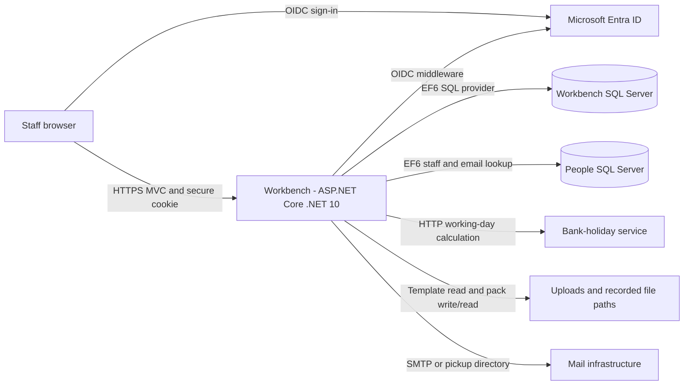

# Assessment - RPA.Inspections.Workbench

## Identification

**Repository Name**: rpa-inspections-workbench (solution: `RPA.Inspections.Workbench`)
**Type**: Web Application (ASP.NET Core MVC, server-rendered Razor views)
**Language**: C#
**Frameworks**: .NET 10 (`net10.0`), Entity Framework 6.5.2, Microsoft.Identity.Web 4.16.1, EPPlus 4.5.3.3, X.PagedList.Mvc.Core 10.6.0
**Repository URL**: Local workspace — `rpa-inspections-workbench`; remote URL not verified
**Assessment Date**: 2026-11-03
**Scope**: Static assessment of current application/test source, configuration, deployment-artifact inventory and documentation. No AppCAT scan, dependency/security scan, build, test execution or deployed-environment verification was performed for this report.

Evidence: [application project](..\RPA.Inspections.Workbench\RPA.Inspections.Workbench.csproj), [startup](..\RPA.Inspections.Workbench\Program.cs), [README](..\README.md).

## Summary

RPA.Inspections.Workbench supports cattle inspection administration: holdings and breeds, inspector assignment, scheme years, archived holdings, inspection-pack requests/downloads and BCMS report requests. It imports spreadsheets and contains Excel inspection-pack generation services. These responsibilities are evidenced by the [Admin](..\RPA.Inspections.Workbench\Controllers\AdminController.cs), [Holding](..\RPA.Inspections.Workbench\Controllers\HoldingController.cs), [BCMS](..\RPA.Inspections.Workbench\Controllers\BcmsAdminController.cs) controllers and [FileService](..\RPA.Inspections.Workbench\Services\FileService.cs).

The web/authentication modernization is already present: .NET 10 hosting, centralized registration through `Program.cs` → `AddWorkbenchApplication`, single-tenant Entra authorization-code OIDC, secure cookie sessions and explicit role policies. Current runtime does **not** load IDT SQL roles, use ASP.NET Membership, or register Windows/Negotiate authentication. There is **no automatic IDT role migration**: identity owners must approve and assign four distinct Entra app-role values and issue the required staff-number claim. The audit claim continues to drive People lookups and pack ownership. See [ApplicationServices](..\RPA.Inspections.Workbench\Services\ApplicationServices.cs), [AuditIdentity](..\RPA.Inspections.Workbench\Services\AuditIdentity.cs) and [deployment prerequisites](..\README.md).

This is not yet demonstrated as deployment-ready. EF6 SQL access, Windows Integrated Security connection settings, local pack/template storage, a bank-holiday HTTP service and SMTP/pickup delivery remain. Live tenant permission/audit acceptance, infrastructure provisioning and operational validation are outstanding evidence gaps. Historical framework/IDT/EDMX conclusions must not be substituted for the current source.

## Service Dependencies

### Cloud Services (GCP/AWS/Azure)
- **Microsoft Entra ID**: Required external identity provider through Microsoft.Identity.Web. Configuration validates a single tenant and application ID, HTTPS authority, client secret, role mappings and audit claim configuration. Missing required settings prevent startup. [Evidence](..\RPA.Inspections.Workbench\Services\ApplicationServices.cs).
- No AWS/GCP service SDK, Azure storage integration or explicit Application Insights registration was found in the application project/startup. Standard ASP.NET Core logging is configured; deployed telemetry wiring was not inspected.

### Databases
- **Workbench SQL Server**: `WorkbenchContext` contains holdings, cattle, breeds, linked holdings, inspection and BCMS requests, inspectors and scheme controls. The current model is an EF6 `DbContext` with POCO entities and explicit migrations; no EDMX artifact was found in the inspected source tree. It is not an EF Core application. [Context](..\RPA.Inspections.Workbench\DAL\WorkbenchContext.cs), [provider configuration](..\RPA.Inspections.Workbench\DAL\WorkbenchDbConfiguration.cs), [migrations configuration](..\RPA.Inspections.Workbench\Migrations\Configuration.cs).
- **People SQL Server**: Direct EF6 access to People, Locations and Managers remains. Staff numbers resolve user names, email addresses and holding assignments; no replacement People HTTP client was found. [PeopleContext](..\RPA.Inspections.Workbench\DAL\PeopleContext.cs), [UserHelper](..\RPA.Inspections.Workbench\Helpers\UserHelper.cs), [HoldingService](..\RPA.Inspections.Workbench\Services\HoldingService.cs).
- Base configuration uses Integrated Security for both SQL connections; environment files override the Workbench connection. Entra browser sign-in does not supply the database process identity or migrate these connections. Current registration requires only Workbench and People connections, not an IDT Security connection. [Configuration](..\RPA.Inspections.Workbench\appsettings.json), [registration](..\RPA.Inspections.Workbench\Services\ApplicationServices.cs).

### Messaging
- No broker, queue or service-bus integration was found in the inspected runtime source.
- Email delivery is implemented separately through SMTP or a pickup directory; database request flags are not evidence of a message broker.

### Storage
- **Application-base `Uploads` directory**: Holds published Excel templates, temporary bulk-import files and generated inspection packs. `PathBuilder` resolves it from the application base directory; imports write/delete files and pack generation saves Excel files there. The project copies templates to build/publish output. This requires writable storage, collision/concurrency consideration and persistence across deployments/replicas. [FileService](..\RPA.Inspections.Workbench\Services\FileService.cs), [project](..\RPA.Inspections.Workbench\RPA.Inspections.Workbench.csproj).
- **Database-recorded file paths**: Pack downloads/deletions and BCMS report retrieval use paths recorded in request entities. Storage changes must preserve or migrate those references, not just copy templates. [HoldingController](..\RPA.Inspections.Workbench\Controllers\HoldingController.cs), [BcmsAdminController](..\RPA.Inspections.Workbench\Controllers\BcmsAdminController.cs), [PackRequestedService](..\RPA.Inspections.Workbench\Services\PackRequestedService.cs).
- **Static images/scripts/styles**: Served from `wwwroot` by `UseStaticFiles`; images are not evidence of a separate mutable upload store. No Blob Storage SDK or abstraction is currently registered.
- **Mail pickup share**: The default mail configuration points to a Windows UNC pickup directory. Accessibility and supported delivery behavior must be validated for the chosen host. [SendService](..\RPA.Inspections.Workbench\Services\SendService.cs).

### APIs and External Integrations
- **Bank-holiday working-days service**: Typed `HttpClient` calls the configured working-days endpoint using `start`/`end` query parameters and parses an integer response. Base configuration selects an internal HTTP endpoint. The handler supplies default credentials to the proxy; this is not evidence that Entra tokens authenticate the downstream service. [HolidayService](..\RPA.Inspections.Workbench\Services\HolidayService.cs), [client registration](..\RPA.Inspections.Workbench\Services\ApplicationServices.cs).
- **Email delivery**: `SendService` selects SMTP network delivery when `Mail:Host` is populated, otherwise specified-pickup-directory delivery. Notification construction and spreadsheet workflow remain in source; pack-request creation has its old email-send call commented out, so email must not be assumed to run for every request. [SendService](..\RPA.Inspections.Workbench\Services\SendService.cs), [MailService](..\RPA.Inspections.Workbench\Services\MailService.cs), [PackRequestedService](..\RPA.Inspections.Workbench\Services\PackRequestedService.cs).
- **Browser links**: Notification bodies contain a fixed internal Workbench HTTP link; the layout also links to internal guidance. These are navigation dependencies, not discovered backend API integrations. [MailService](..\RPA.Inspections.Workbench\Services\MailService.cs), [layout](..\RPA.Inspections.Workbench\Views\Shared\_Layout.cshtml).

### Other Dependencies
- EF6 retains the SQL Server `System.Data.SqlClient` provider; an EF Core migration has not occurred.
- EPPlus handles workbook imports and macro-enabled Excel pack templates. Template fidelity must be retained when moving storage or updating the library.
- Locally served jQuery, jQuery UI, Bootstrap and compatibility scripts remain in the Razor layout. Their presence/version strings are static evidence, not a vulnerability scan.
- `AddMemoryCache` is process-local; ASP.NET Core authentication also requires a deliberate data-protection key persistence/sharing strategy. No explicit production key-store registration is present in `ApplicationServices`.

## Communication

### Exposed Endpoints

The conventional route is `{controller=Home}/{action=Index}/{id?}`. Parameters such as holding IDs and file paths are action parameters, commonly supplied through query strings or forms. The table lists current action routes, not speculative REST APIs. **GET*** means a browser GET is supported but the action has no HTTP-method constraint; it is not restricted to GET by an attribute.

| Method | Path | Description | Authentication |
|--------|------|-------------|----------------|
| GET* | `/`, `/Home/Index` | Landing page and policy-controlled navigation | Entra session + Basic Access policy |
| GET* | `/Admin`, `/Admin/Index` | Bulk-upload administration screen | Admin policy |
| POST | `/Admin`, `/Admin/Index` | Import inspection spreadsheet; optional data clearing | Admin **and** Super User policies; antiforgery validation |
| GET* | `/Admin/BreedList`, `/Admin/HoldingList`, `/Admin/ArchiveAdmin`, `/Admin/ArchivedList`, `/Admin/ViewArchivedHolding` | List/search current or archived reference/holding data | Admin policy |
| GET* / POST | `/Admin/AddBreed`, `/Admin/ViewBreed`, `/Admin/AddHolding`, `/Admin/ViewHolding` | Display/create/edit breed or holding records | Admin policy; antiforgery validation on POST |
| GET* | `/Admin/InspectorList`, `/Admin/AddInspector`, `/Admin/RemoveInspector` | Inspector listing/form/removal; removal changes data | Admin policy |
| POST | `/Admin/AddInspector` | Add inspector | Admin policy; antiforgery validation |
| GET* / POST | `/Admin/SchemeYearAdmin` | Display/update scheme controls | Admin policy; antiforgery validation on POST |
| GET* | `/Admin/AddSchemeYear`, `/Admin/PeopleSearch` | Create next scheme year; return People search JSON | Admin policy |
| GET* | `/Holding`, `/Holding/Index`, `/Holding/ViewHolding`, `/Holding/PacksRequested` | Holding search/details and outstanding pack requests | Authenticated session via fallback policy |
| POST | `/Holding/PackRequest`, `/Holding/PeopleUpdate` | Record pack request; attempt current-user email update | Authenticated session via fallback policy |
| GET* | `/Holding/GetPack`, `/Holding/DeletePack` | Download recorded pack or delete/hide it; deletion changes data | Authenticated session via fallback policy |
| GET* | `/BcmsAdmin`, `/BcmsAdmin/Index`, `/BcmsAdmin/open_report` | Recent BCMS requests and recorded HTML report retrieval | BCMS policy |
| POST | `/BcmsAdmin/BulkRequest`, `/BcmsAdmin/SpecificRequest` | Persist bulk/date-range or holding-specific BCMS request | BCMS policy |
| GET | `/Account/AccessDenied`, `/Account/AuthenticationFailed` | Safe 403 and 401 responses | Explicitly anonymous |
| OIDC callback | `/signin-oidc` | Configured identity-provider callback, handled by middleware | OIDC protocol validation; not an MVC business action |
| Unconstrained | `/Error` | Production exception-handler route | No anonymous override; fallback authentication policy applies |

Evidence: [routing](..\RPA.Inspections.Workbench\Program.cs), [Admin](..\RPA.Inspections.Workbench\Controllers\AdminController.cs), [Holding](..\RPA.Inspections.Workbench\Controllers\HoldingController.cs), [BCMS](..\RPA.Inspections.Workbench\Controllers\BcmsAdminController.cs), [Home](..\RPA.Inspections.Workbench\Controllers\HomeController.cs), [Account](..\RPA.Inspections.Workbench\Controllers\AccountController.cs), [Error](..\RPA.Inspections.Workbench\Controllers\ErrorController.cs), [policies](..\RPA.Inspections.Workbench\Services\ApplicationServices.cs).

### Consumed Endpoints
- **GET configured bank-holiday URL** ending in `/api/Values/workingdays`, with `?start=...&end=...`: working-day calculation. The environment-specific hostname is intentionally omitted. Calls synchronously wait on `GetStringAsync`; errors are wrapped as holiday-service unavailability. [Implementation](..\RPA.Inspections.Workbench\Services\HolidayService.cs).
- **Entra OIDC endpoints**: Authorization-code flow through configured authority/tenant and Microsoft.Identity.Web. Endpoint discovery/token handling is middleware-managed, not a bespoke business HTTP client. [Registration](..\RPA.Inspections.Workbench\Services\ApplicationServices.cs).
- SQL and SMTP/pickup-directory access are non-HTTP integrations. No consumed People API route was found.

### Asynchronous Communication
- Pack requests persist `activeRequest`, requester information and timestamps; BCMS requests persist `ActiveRequest`, date ranges or holding/scheme identifiers. UI retrieval reads status and recorded file paths. [Pack request service](..\RPA.Inspections.Workbench\Services\PackRequestedService.cs), [BCMS controller](..\RPA.Inspections.Workbench\Controllers\BcmsAdminController.cs).
- No hosted background worker, scheduler or broker consumer was found in startup/registration. Database flags suggest a deferred-processing hand-off, but the responsible external processor and deployment contract are **not established by this source**.
- SMTP sending and the holiday HTTP wait are synchronous. OIDC event callbacks being asynchronous do not constitute a business messaging integration.

### Communication Diagram

The diagram shows source-evidenced dependencies, not a verified deployed topology; no unlocated request processor is depicted as an implemented service.

## Configuration

### Environment Variables
- ASP.NET Core's default builder loads configuration; environment variables can override nested keys using `__`. These are supported configuration inputs, not evidence that they have been supplied in a deployment. [Program](..\RPA.Inspections.Workbench\Program.cs), [README](..\README.md).
- Required identity inputs include `AzureAd__TenantId`, `AzureAd__ClientId`, `AzureAd__ClientSecret`, `Identity__AuditNameClaimType` and `Authorization__BasicAccessRole`, `Authorization__AdminRole`, `Authorization__SuperUserRole`, `Authorization__BcmsRole`. Authority/callback settings are under `AzureAd`.
- SQL settings are `ConnectionStrings__WorkbenchContext` and `ConnectionStrings__PeopleContext`; mail uses `Mail__Host`, `Mail__Port`, `Mail__PickupDirectory`; holiday access uses `HolidayService__WorkingDaysUrl`.
- `ApplyMigrationsOnStartup` defaults to false. `ASPNETCORE_ENVIRONMENT` selects normal environment-specific settings; no deployed value was verified.

### Configuration Files
- [appsettings.json](..\RPA.Inspections.Workbench\appsettings.json): Logging, allowed hosts, startup migration switch, identity placeholders, SQL connections, mail and holiday-service settings.
- [appsettings.SIT.json](..\RPA.Inspections.Workbench\appsettings.SIT.json), [appsettings.UAT.json](..\RPA.Inspections.Workbench\appsettings.UAT.json), [appsettings.Production.json](..\RPA.Inspections.Workbench\appsettings.Production.json): Workbench connection overrides. They do not independently supply the required identity settings.
- [ApplicationServices.cs](..\RPA.Inspections.Workbench\Services\ApplicationServices.cs): Central configuration validation, identity/cookie/policy setup and dependency registration.
- [project file](..\RPA.Inspections.Workbench\RPA.Inspections.Workbench.csproj): SDK-style package references and template publishing. No current `packages.config`, `Web.config` transforms or EDMX files were found in the inspected project tree.

### Secrets and Sensitive Parameters
- `AzureAd:ClientSecret` is required externally and is not supplied in base settings. Tenant/application identifiers and role values also require environment-specific approval; none are reproduced here.
- Committed SQL settings use Integrated Security rather than embedded SQL passwords. That still requires process-account permissions, network access and a supported hosting identity model; it does not mean database access is secret-free or portable.
- Internal SQL/service addresses, the mail pickup location, sender configuration, file paths and People/requester data require controlled deployment configuration and appropriate access controls. Values are intentionally omitted from this report.
- `AuditNameClaimType` must identify the real People staff number or compatible domain-qualified account claim. Validation rejects missing/duplicate/empty or non-alphanumeric normalized values, but cannot prove a claim represents the correct business identity; live issuance/mapping acceptance is required. [AuditIdentity](..\RPA.Inspections.Workbench\Services\AuditIdentity.cs), [UserHelper](..\RPA.Inspections.Workbench\Helpers\UserHelper.cs).

## Infrastructure

### Containerization
- **Dockerfile/base image/declared container ports**: None found in the project inventory.
- .NET 10 does not by itself establish Linux/container readiness: Integrated Security, UNC pickup delivery, writable application-base storage and external file producers remain to be addressed.

### Kubernetes/Helm
- **Manifests/Helm charts**: None found in this application's inspected tree. No replica, persistent-volume, ingress or secret-store deployment contract was found.

### Infrastructure as Code
- **Terraform/Bicep/ARM/CloudFormation**: No provisioning templates found in the inspected application tree.
- Azure hosting, networking, SQL placement, storage and secret/key management are recommendations to design, not resources proven to exist.

### CI/CD
- No application-specific pipeline YAML or deployment scripts were found in the inspected tree. Existing `bin`/`obj` outputs do not establish a reproducible delivery pipeline or validation result for this assessment.
- Startup comments/README describe schema changes as deployment-managed, but no implementing pipeline was found. The optional `DbMigrator` path uses the configured Workbench connection; automatic EF migrations are disabled. [Startup](..\RPA.Inspections.Workbench\Program.cs), [migration configuration](..\RPA.Inspections.Workbench\Migrations\Configuration.cs).

### Legacy Deployment Artifacts
- The project retains `AspNetCoreHostingModel=InProcess`, an IIS hosting setting for ASP.NET Core, **not** evidence that the current application still uses MVC 5/.NET Framework.
- README documents IIS/reverse-proxy prerequisites: anonymous host access, Windows authentication disabled for browser sign-in, HTTPS/callback registration, trusted forwarding configuration at the hosting layer and persisted/shared data-protection keys. No production fulfillment was verified.
- The [October assessment export](..\docs\Report_20261006101749_20261006105014.md) is a historical artifact. Its AppCAT results and legacy deployment descriptions are not a fresh assessment of this source.

## Testing

### Coverage
- **Percentage**: Not measured in this assessment; no coverage percentage is asserted.
- **Tooling**: Current `net10.0` test project references NUnit 3.14.0, NUnit3TestAdapter 6.3.1, Moq 4.20.72, Microsoft.NET.Test.Sdk 18.11.0 and Microsoft.AspNetCore.Mvc.Testing 10.0.13. No coverage collector is explicitly referenced in the test project. [Project](..\RPA.Inspections.Workbench.Tests\RPA.Inspections.Workbench.Tests.csproj).

### Test Types
- **Unit**: Attribute validation, cattle calculations, breed/holding/linked-holding services, pack requests, spreadsheet models, file and mail services; EF contexts and external services are mocked in representative tests. [File-service example](..\RPA.Inspections.Workbench.Tests\Services\FileServiceTests.cs).
- **Authentication/policy tests**: Explicit role separation, configuration rejection, audit normalization, People lookup/ownership and helper fallback behavior. [AuthenticationTests](..\RPA.Inspections.Workbench.Tests\Authentication\AuthenticationTests.cs).
- **Offline host integration tests**: `WebApplicationFactory<Program>` exercises OIDC challenges, cookies, safe failure endpoints, policy-controlled MVC/navigation and combined Admin/Super User enforcement. Test-only session endpoints belong to the test assembly, not production routes. [AuthenticationHostTests](..\RPA.Inspections.Workbench.Tests\Authentication\AuthenticationHostTests.cs).
- **Signed-token validation tests**: Local keys/static identity configuration cover valid and invalid tenant/audience/signature/expiry/audit cases through Microsoft.Identity.Web validation. [SignedTokenAuthenticationTests](..\RPA.Inspections.Workbench.Tests\Authentication\SignedTokenAuthenticationTests.cs).
- **Live integration/E2E**: No verified real-tenant, SQL, SMTP, holiday-service or deployed-browser acceptance results were established in this assessment.

### Observations
- Test source demonstrates intended checks, not current pass/fail results. No build or test command was run to author this document; existing build outputs and historical documentation were not treated as fresh evidence.
- The [README](..\README.md) provides build and focused authentication-test commands and explicitly requires real tenant sign-in and representative staff-number/permission acceptance before go-live.
- Include deployment acceptance for database identity/schema access, template publishing and generated-file retention, mail delivery, holiday service connectivity, reverse-proxy callback behavior and multi-replica/restart cookie continuity.

## Points of Attention for Multi-Cloud/Azure Migration

### Cloud-Specific Dependencies
- Entra is now an intentional identity dependency. A different hosting cloud would still need connectivity and the approved Entra application/claim contracts unless identity is separately redesigned.
- SQL Server/EF6 are not Azure-only, but Windows Integrated Security and the UNC mail pickup setting couple the supplied configuration to the existing Windows/network environment.
- No Azure-native persistence, messaging or secret-store integration is currently evidenced. Adding Azure hosting does not automatically replace disk storage, SQL identities or email infrastructure.

### Hardcoded Configurations
- Base/environment settings retain internal SQL/service addressing, an HTTP holiday endpoint and a UNC pickup path. Externalize and validate these per deployment without exposing sensitive endpoint values.
- Notification HTML embeds an internal Workbench HTTP URL and fixed sender addresses; move deployment-dependent URL/sender choices into configuration. [MailService](..\RPA.Inspections.Workbench\Services\MailService.cs).
- Template/output paths are tied to the application-base `Uploads` directory, while database records retain generated-file paths. Introduce a storage contract before relocating outputs; static `wwwroot` images need not be treated as mutable business storage.

### Legacy Code or Old Patterns
- **Already modernized**: Do not plan another MVC 5 → ASP.NET Core or Membership/IDT → Entra conversion as if it were pending. The current project is .NET 10 with centralized startup and explicit authorization policies.
- **Still retained**: EF6 SQL-provider/migration patterns, synchronous database/mail work and blocking HTTP calls; older frontend assets and EPPlus remain. An EF Core migration would be a separate tested data-access change, not a prerequisite implied by an EDMX that is absent here.
- **Permission/audit compatibility**: Four app-role values must be distinct; policies have no implicit hierarchy. Super User alone does not grant Admin; bulk upload requires both. Home requires Basic Access, BCMS requires BCMS, and Holding remains authenticated-only. Navigation uses corresponding policies. No IDT role import/translation runs. [Registration](..\RPA.Inspections.Workbench\Services\ApplicationServices.cs), [navigation](..\RPA.Inspections.Workbench\Views\Home\Index.cshtml).
- **Operational concurrency**: A process-local lock around pack creation does not coordinate replicas. Generated-file naming/storage and request processing need multi-instance acceptance. [PackRequestedService](..\RPA.Inspections.Workbench\Services\PackRequestedService.cs), [FileService](..\RPA.Inspections.Workbench\Services\FileService.cs).

### Specific Recommendations
1. Complete identity-owner approval and assignments for all four app roles, staff-number claim issuance and representative allow/deny/audit tests. Preserve Workbench's existing normalization and uppercase requester recording; do not substitute email, display name or object ID for People staff numbers.
2. Verify production OIDC callback/HTTPS behavior, host-level anonymous access and disabled Windows browser authentication. Configure trusted forwarding at the appropriate hosting layer and persist/share protected data-protection keys across restarts/replicas.
3. Decide and prove the SQL runtime identity/networking model for both databases before selecting a Linux/container target. Evaluate Azure SQL options only with schema/provider/authentication compatibility tests; Entra user sign-in is not a database-identity migration.
4. Separate immutable Excel templates from mutable pack/report storage. Evaluate shared durable storage or Blob Storage behind an application abstraction; migrate recorded path references and validate workbook/macros, retention, downloads and producer compatibility.
5. Inventory the actual deferred pack/BCMS processors and hand-off contracts with operations. Preserve database status/audit semantics until their ownership, scheduling, retries and file production are understood; do not assume the web app hosts a worker.
6. Parameterize holiday, notification and mail settings; validate HTTPS availability, proxy/network behavior and failure handling. Choose an approved SMTP/transactional delivery mechanism or prove supported pickup behavior for the target host.
7. Retain the current EF6 behavior initially where supported; treat any EF Core or People API replacement as a separate compatibility project. The People dependency includes staff-number, email and assignment semantics, so an API replacement requires a verified contract rather than a guessed route.
8. Add reproducible build/test/publish and deployment-managed schema steps, environment configuration validation and operational acceptance evidence before go-live. Run current dependency/frontend inventory and security checks separately; this static report does not certify vulnerability status.

## Additional Observations
- The historical report under `docs` describes October assessment runs; it is useful context, not proof of today's runtime or current vulnerability state. This report supersedes the stale local report's .NET Framework/Membership/IDT/EDMX claims for current-source assessment.
- The README is now operational documentation, not an untouched scaffold: it explicitly states no IDT role migration and lists deployment acceptance prerequisites.
- `/Holding/PeopleUpdate` modifies People entities but calls the Workbench context's `SaveChanges`; successful persistence to People is not demonstrated by the implementation. Include this behavior in acceptance tests rather than assuming it works. [Controller](..\RPA.Inspections.Workbench\Controllers\HoldingController.cs).
- Some state-changing actions lack explicit POST constraints, while antiforgery annotations are present on Admin POST actions but not all Holding/BCMS POST actions. Record these as observable legacy HTTP patterns for a focused follow-up; this assessment did not perform an exploitability review.
- BCMS naming and database flags establish request/report functionality, not a verified direct cattle-tracing-system API or a located external processor. Confirm those operational/business interfaces with owners.
- Verification basis: direct reads of current project/startup/services/controllers/views/configuration/test source and README, plus a source-tree deployment-artifact inventory and relative evidence-link checks. No cloud resource was queried or changed, and no application code was modified.
